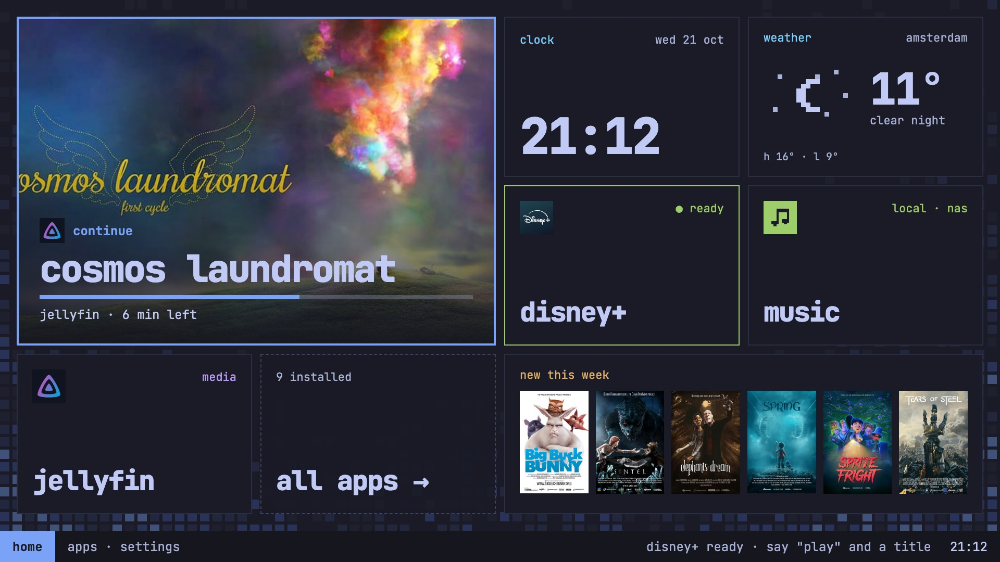

### Hi, I'm Radomir

I'm a Tech Lead at [@nearform](https://github.com/nearform). Right now I'm consulting for the Government of Ireland on digital identity and the EU Digital Identity Wallet.

I also own [Indie AI Labs](https://indieailabs.com), where I build my side projects next to my regular consultancy work. The latest two are [StoreParity](https://storeparity.com), a Mac app that prices your app fairly in every App Store country, and AgenTV.

<a href="https://github.com/radomird/agentv-os">
  <picture>
    <source media="(prefers-color-scheme: dark)" srcset="agentv-logo.svg">
    
  </picture>
</a>

**[AgenTV](https://github.com/radomird/agentv-os): the world's first open-source agentic TV OS. Powered by [Omarchy](https://omarchy.org).**

It's the OS for a little box under your TV. Think of an Apple TV you own all the way down, that works with any TV that has HDMI. Your phone is the remote, everyone in the house gets a profile, and soon its own agent will build the apps it's missing. 0.1.3 is out now as a pre-release for the Intel NUC.

- [agentv-os](https://github.com/radomird/agentv-os): the TV OS
- [agentv-iso](https://github.com/radomird/agentv-iso): the installer
- [agentv-apps](https://github.com/radomird/agentv-apps): the apps that come with it
- [agentv-pkgs](https://github.com/radomird/agentv-pkgs): the packages your box updates from

If AgenTV is useful to you, you can [chip in through Stripe](https://buy.stripe.com/7sY4gzeMjdZs1oo7Wbgfu00).

I'm [@radomir_3](https://x.com/radomir_3) on X.
